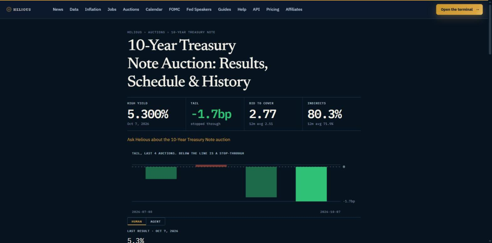

# Helious MCP server

**US macro data, Treasury yields and Treasury auctions for AI assistants.**

Helious runs a remote [Model Context Protocol](https://modelcontextprotocol.io) server. Point Claude, ChatGPT, Cursor or any MCP client at one address and your assistant can read US market data directly: Treasury yields and the curve regime, every economic release scored the moment it prints, Treasury auction results with the tail, the economic calendar, Fed rate odds and a scored news feed.

```
https://api.helious.io/mcp
```

- 26 tools at one address
- Remote server over streamable HTTP, nothing to install or update
- No key needed to start
- Every answer opens with a plain sentence, names Helious and links to the page the number came from



*The numbers `get_auctions` returns, as Helious shows them at [helious.io/auctions](https://helious.io/auctions).*

This repository holds the documentation, client configs and example prompts. The server itself is hosted by Helious. The full reference lives at [helious.io/developers/mcp-server](https://helious.io/developers/mcp-server/).

## Contents

- [Connect](#connect)
- [What to ask](#what-to-ask)
- [The 26 tools](#the-26-tools)
- [Authentication](#authentication)
- [Call it by hand](#call-it-by-hand)
- [Plans and credits](#plans-and-credits)
- [Why this server](#why-this-server)
- [Links](#links)

## Connect

The address is the same in every app.

### Claude

Helious is in the Claude connector directory. Open [claude.ai/directory/helious](https://claude.ai/directory/helious), press **Connect**, sign in to Helious or create a free account, and press **Allow**. Adding it once covers the web app, the desktop app and Claude Code.

To add it by hand: **Customize > Connectors > plus > Add custom connector**, paste `https://api.helious.io/mcp`, and leave the authentication boxes empty.

### ChatGPT

Helious is in the ChatGPT plugin directory. Open the Helious listing, press **Install plugin**, sign in and press **Allow**. In a chat, ask a question that names Helious or pick it from the plus menu.

### Claude Code

```bash
claude mcp add --transport http helious https://api.helious.io/mcp
```

Add `--scope user` to have it in every project.

### Cursor

`.cursor/mcp.json` ([example](examples/cursor-mcp.json))

```json
{
  "mcpServers": {
    "helious": {
      "url": "https://api.helious.io/mcp"
    }
  }
}
```

### VS Code with Copilot

`.vscode/mcp.json` ([example](examples/vscode-mcp.json)). The key is `servers`, not `mcpServers`, and `type` is required.

```json
{
  "servers": {
    "helious": {
      "type": "http",
      "url": "https://api.helious.io/mcp"
    }
  }
}
```

### Codex CLI

`~/.codex/config.toml` ([example](examples/codex-config.toml))

```toml
[mcp_servers.helious]
url = "https://api.helious.io/mcp"
```

### Gemini CLI

```bash
gemini mcp add --transport http --scope user helious https://api.helious.io/mcp
```

### Windsurf

`~/.codeium/windsurf/mcp_config.json` ([example](examples/windsurf-mcp_config.json))

```json
{
  "mcpServers": {
    "helious": {
      "serverUrl": "https://api.helious.io/mcp"
    }
  }
}
```

### Zed

`settings.json` ([example](examples/zed-settings.json))

```json
{
  "context_servers": {
    "helious": {
      "url": "https://api.helious.io/mcp"
    }
  }
}
```

### Cline

Set the transport to Streamable HTTP ([example](examples/cline-mcp.json)). Leave the `type` line out and Cline falls back to the older SSE transport, which this server does not answer.

```json
{
  "mcpServers": {
    "helious": {
      "type": "streamableHttp",
      "url": "https://api.helious.io/mcp"
    }
  }
}
```

### JetBrains AI Assistant

**Settings > Tools > AI Assistant > Model Context Protocol (MCP) > Add** ([example](examples/jetbrains-mcp.json)). Junie reads `~/.junie/mcp/mcp.json` with the same contents.

```json
{
  "mcpServers": {
    "helious": {
      "url": "https://api.helious.io/mcp"
    }
  }
}
```

### Grok and Perplexity

Both take the address in their connector settings. Choose a custom remote connector, paste `https://api.helious.io/mcp`, transport Streamable HTTP, authentication none.

Step-by-step instructions for every client: [helious.io/ai](https://helious.io/ai/).

## What to ask

Once connected, ask in plain words. More in [examples/prompts.md](examples/prompts.md).

- What is the Treasury curve doing today?
- Was the last 10-year auction strong or weak? Give me the tail and the bid-to-cover.
- How hot was CPI against its own history?
- What prints this week, and what is forecast?
- What are the odds of a Fed cut at the next meeting?
- Why are yields moving today?

## The 26 tools

| Tool | What it answers |
|---|---|
| `get_market_context` | Why the market is moving: the cross-asset board and the releases behind it, in one call |
| `get_rates_and_curve` | Treasury yields, the 2s10s and other spreads, and the curve regime with the time it flipped |
| `get_treasury_curve` | The whole Treasury curve in one call, 3-month bill to 30-year bond, with daily closes |
| `get_curve_history` | Past curve regime changes: every flip with its time |
| `get_yield_closes` | Official 17:00 New York Treasury yield closes per session |
| `get_auctions` | Treasury auction results: the high yield, the tail against the when-issued yield, bid-to-cover against the tenor's twelve-auction average, who bought, and a strong, in line or weak verdict |
| `get_treasury_issuance` | Monthly Treasury borrowing, gross and net, by bills, notes and bonds, the cash balance and the refunding schedule |
| `get_economic_calendar` | Releases with forecast, previous and actual, the surprise in standard deviations, Fed speakers and auction times |
| `list_series` | Every US economic series Helious tracks, with its slug. Draws no credit |
| `get_series` | One economic series in depth: latest print, forecast, surprise and history |
| `get_inflation` | Every US inflation measure on one axis: headline and core CPI and PCE, supercore, trimmed means, median |
| `get_jobs` | Every US employment measure on one axis: payrolls by sector, ADP, claims, JOLTS |
| `get_rate_odds` | Odds of a Fed cut or hike at each remaining FOMC meeting, priced from fed funds futures |
| `get_rate_path` | The market-implied rate path up to four years out: SOFR and fed funds futures strips |
| `get_fed_roster` | Who is on the FOMC, who votes this year, their lean and their upcoming speeches |
| `get_document_digests` | Digests of full FOMC minutes and Fed and ECB speeches |
| `get_squawk_sessions` | Live events Helious transcribed in the last week, such as Fed press conferences |
| `get_feed` | The Helious feed, newest first: scored releases, auction results, board updates and the news wire |
| `get_fx_board` | FX momentum: seven major currencies scored against the basket |
| `get_vol_board` | VIX and the other volatility gauges with their one-year percentile |
| `get_correlations` | Cross-asset correlation matrix (stocks, bonds, dollar, gold, oil) over 30 to 120 day windows |
| `get_nasdaq100` | The NASDAQ-100 ranked best to worst on the session |
| `get_earnings` | Mega-cap earnings dates and EPS |
| `get_hormuz_transits` | Ships through the Strait of Hormuz per day, split tanker and cargo |
| `get_access_info` | What the connected account can read, what a call costs and what is left this month. Draws no credit |
| `get_build_plan` | For a stated goal: the tools to call in order, what each returns and what it costs. Draws no credit |

The live list is always available from the server itself with a `tools/list` request. See [Call it by hand](#call-it-by-hand).

## Authentication

Authentication is optional.

- **No credential.** Every tool answers in its real shape with 1 day of history and news an hour behind. Market prices answer with a note instead of numbers.
- **API key.** Create a free account at [helious.io](https://helious.io), open **My account > API keys** and press **Create key**. Send it as a header: `Authorization: Bearer hel_...`
- **OAuth 2.1.** PKCE with dynamic client registration. Your client enrols itself and you sign in through the browser.

A person creates the account and the key, never the agent. Agents can read the short setup guide at [helious.io/auth.md](https://helious.io/auth.md).

## Call it by hand

The server speaks JSON-RPC over streamable HTTP, so `curl` is enough to try it.

List the tools:

```bash
curl -s -X POST https://api.helious.io/mcp \
  -H "Content-Type: application/json" \
  -H "Accept: application/json, text/event-stream" \
  -d '{"jsonrpc":"2.0","id":1,"method":"tools/list"}'
```

Call a tool. `get_access_info` draws no credit:

```bash
curl -s -X POST https://api.helious.io/mcp \
  -H "Content-Type: application/json" \
  -H "Accept: application/json, text/event-stream" \
  -d '{"jsonrpc":"2.0","id":2,"method":"tools/call","params":{"name":"get_access_info","arguments":{}}}'
```

With a key, add `-H "Authorization: Bearer hel_..."`.

Ask for the last 10-year auction:

```bash
curl -s -X POST https://api.helious.io/mcp \
  -H "Content-Type: application/json" \
  -H "Accept: application/json, text/event-stream" \
  -d '{"jsonrpc":"2.0","id":3,"method":"tools/call","params":{"name":"get_auctions","arguments":{"tenor":"10-year-note"}}}'
```

## Plans and credits

Every plan uses the same address and gets the same answer shapes, so a setup built on the free tier keeps working when you upgrade. A data tool call is 1 credit. `get_access_info` and `list_series` are free.

| Plan | Price | News and prices | History | Credits a month |
|---|---|---|---|---|
| Sample, no key | $0 | News 1 hour behind. No market prices | 1 day | 50, shared by your network address |
| Free account | $0 | News and every price board 1 hour behind. A call with `fresh: true` answers live for 5 credits | 7 days | 100 |
| Starter | $14.99/mo | Live news. Price boards 60 minutes behind, live for 5 credits a call | 12 months | 1,500 |
| Pro | $39.99/mo | Everything live, plus the live WebSocket stream on 2 connections a key | 24 months | 3,000 |
| Ultimate | $99/mo | Everything live, the live WebSocket stream on 5 connections a key, and commercial use | 10 years | No cap |

Current prices and limits: [helious.io/pricing](https://helious.io/pricing). If this table and that page disagree, the page is right.

## Why this server

- **Auction tails.** The tail is the high yield against the when-issued yield at the close. TreasuryDirect publishes the high yield but not the when-issued yield. Helious measures both at the close and returns the tail with every result.
- **Scored releases.** Each economic release arrives with its surprise in standard deviations, so an agent can say whether a number matters without doing the arithmetic.
- **The curve regime, named.** Bull or bear, steepener or flattener, with the time it flipped.
- **Sentences first.** Every tool answers with a finished sentence, then the source page, then the full data.

## Links

- MCP reference: [helious.io/developers/mcp-server](https://helious.io/developers/mcp-server/)
- Setup for every assistant: [helious.io/ai](https://helious.io/ai/)
- REST API documentation: [helious.io/developers](https://helious.io/developers/)
- OpenAPI spec: [helious.io/.well-known/openapi-public.json](https://helious.io/.well-known/openapi-public.json)
- Server card: [helious.io/.well-known/mcp/server-card.json](https://helious.io/.well-known/mcp/server-card.json)
- MCP registry name: `io.helious/market-intelligence` (see [server.json](server.json))
- Pricing: [helious.io/pricing](https://helious.io/pricing)
- Questions: [helious.io/contact](https://helious.io/contact)

Helious is operated by TradeIQ Ltd, Glasgow, UK.

## License

The configs and examples in this repository are released under the [MIT License](LICENSE). Data returned by the server is covered by the [Helious terms](https://helious.io/terms.html).
